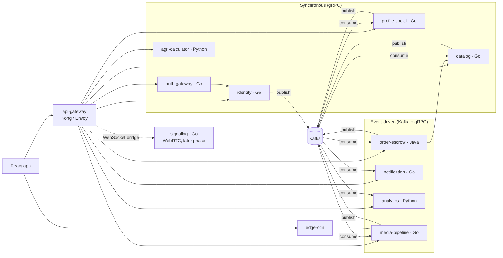

# AGROGRAM backend

Polyglot microservices backend for **AGROGRAM**, the marketplace that connects
Uzbek farmers (*dehqon*) with resellers (*olib sotuvchi*). It covers listings,
e-ijara-verified farmers, escrow-protected transactions (*tranzaksiya*), yield
estimation and market statistics.

> **Status: Phase 0, contracts and skeleton only.** This tree holds the service
> contracts (Protobuf/gRPC and Kafka events), code generation (Docker or a
> pinned local buf), and an empty scaffold per service. There is no business
> logic, no database code and no handlers yet.

## Architecture



| Service | Lang | Style | Owns |
| --- | --- | --- | --- |
| [auth-gateway](services/auth-gateway) | Go | gRPC | Sign-in (Google, Apple/iCloud, phone + password), sessions, token issue and verify, JWKS |
| [identity](services/identity) | Go | gRPC | Accounts, role set, e-ijara farmer verification, plan entitlements |
| [profile-social](services/profile-social) | Go | gRPC | Public profiles, follow/unfollow, ratings, a user's own listings |
| [catalog](services/catalog) | Go | gRPC | Farmer offers and reseller buy-requests, search and filter, product reference data |
| [agri-calculator](services/agri-calculator) | Python | gRPC | Yield estimate from crop, area (ha / sotix / m²) and seed amount (Premium) |
| [order-escrow](services/order-escrow) | Java | Kafka + gRPC commands | The *tranzaksiya* escrow state machine |
| [notification](services/notification) | Go | Kafka consumer + gRPC | Push, SMS and in-app inbox; preferences |
| [analytics](services/analytics) | Python | Kafka consumer + gRPC queries | Market statistics (design still being reworked) |
| [media-pipeline](services/media-pipeline) | Go | gRPC + Kafka jobs | Uploads, short-video transcoding, weighbridge-receipt OCR |
| [signaling](services/signaling) | Go | gRPC stream (stub) | WebRTC call signaling. Later phase, contract stub only |
| api-gateway | Kong / Envoy | edge | Token validation, `x-agrogram-*` header injection, gRPC↔JSON. Config comes later |
| edge-cdn | n/a | edge | Delivery of processed media. Config comes later |

- **How traffic flows.** Clients reach services only through the api-gateway.
  Services call each other over gRPC only when they need an immediate answer:
  auth-gateway → identity when it issues tokens, and order-escrow → catalog to
  snapshot a listing into a deal. Everything else propagates as Kafka events.
- **Data ownership.** Each service owns its data, and no two services share a
  database. Read models (listing cards with owner names, profile counters,
  analytics) are projections that each consumer builds from events.

<!-- EVENTS: finalized after contracts land -->

## Repository layout

```
back/
├── proto/                     # the contracts (buf module root)
│   ├── common/v1/             # shared types: error, pagination, money, quantity, product,
│   │                          #   market, address, auth, time, resource, media, locale
│   ├── <service>/v1/          # one .proto per service: its gRPC service + messages
│   └── events/v1/             # Kafka event envelopes and payloads
├── services/<service>/        # scaffold per service: README.md + placeholder Dockerfile
├── deploy/                    # local infra: Postgres, Redis, Kafka, Kafka UI, Adminer
│                              #   (docker-compose.yml, init scripts); see deploy/README.md
├── buf.yaml                   # buf module, lint and breaking rules, deps (protovalidate)
├── buf.lock                   # pinned dependency versions
├── buf.gen.yaml               # codegen: Go, Python, Java via BSR remote plugins
├── tools/                     # shared codegen tooling, used by back/ and every service:
│                              #   buf.version (the one pin), codegen.sh (download, verify,
│                              #   generate, write gen/go/go.mod), gen-go.mod.tmpl, codegen.mk
├── Makefile                   # buf in the bufbuild/buf container, plus proto-gen-local
└── gen/                       # generated code (git-ignored, reproducible)
```

The legacy FastAPI prototype files also live at the root of `back/`. See
[Legacy prototype](#legacy-prototype).

## Code generation

Two paths produce the same `gen/`, both with buf **1.73.0** and BSR *remote*
plugins. You never need a local `protoc` or `protoc-gen-*` plugin.

- **Docker** (`proto-*`): every target runs `bufbuild/buf:1.73.0` in a
  throwaway container as your own user. Requires Docker.
- **Local** (`proto-gen-local`, which is also what each service's `make gen`
  runs): `tools/codegen.sh` downloads the pinned buf release binary into
  `${XDG_CACHE_HOME:-~/.cache}/agrogram/bin` — outside the repo — verifies it
  against the release's `sha256.txt` and reuses it from then on. Requires curl.

```sh
cd back
make help             # list targets
make proto            # format check + lint + generate (what CI should run)
make proto-gen        # generate code into gen/ (Docker)
make proto-gen-local  # the same, with the pinned local buf (no Docker)
make proto-lint       # style, comment and protovalidate rules
make proto-format     # rewrite .proto files canonically
make proto-breaking   # compare with main (after the contracts are committed there)
make proto-deps       # refresh buf.lock after changing deps in buf.yaml
```

Both generating targets also write `gen/go/go.mod` from
`tools/gen-go.mod.tmpl`, which is what makes `gen/go` the Go module the
services `replace`. It has to be rewritten every time because `buf.gen.yaml`
sets `clean: true`.

The shared tooling in `tools/` is the single implementation: `buf.version`
holds the only version pin, `codegen.sh` the only download-and-verify logic and
`gen-go.mod.tmpl` the only module template; `codegen.mk` carries the variables
that `back/Makefile` and every `services/*/Makefile` include. Environment
overrides: `BUF_VERSION`, `TOOLS_DIR` (the binary cache) and `BUF` (path to an
existing buf binary, skipping the download).

Without `make`, run the same command directly:

```sh
docker run --rm -v "$PWD:/workspace" -w /workspace --user "$(id -u):$(id -g)" \
  -e BUF_CACHE_DIR=/workspace/.buf-cache bufbuild/buf:1.73.0 generate
./tools/codegen.sh go-mod   # then write gen/go/go.mod

./tools/codegen.sh generate # or do both with the local buf
```

| Output | Language / import | Plugins (pinned) | Used by |
| --- | --- | --- | --- |
| `gen/go` | `github.com/tbilol/dxrl/gen/go/<dir>/v1`, package `<dir>v1` | `protocolbuffers/go` v1.36.12, `grpc/go` v1.6.2 | auth-gateway, identity, profile-social, catalog, notification, media-pipeline, signaling |
| `gen/python` | `from catalog.v1 import catalog_pb2`, plus `.pyi` stubs and `buf/validate` | `protocolbuffers/python` + `pyi` v36.2, `grpc/python` v1.84.0 | agri-calculator, analytics |
| `gen/java` | `uz.agrogram.<dir>.v1` | `protocolbuffers/java` v36.2, `grpc/java` v1.84.0 | order-escrow |

Notes:

- **Runtime libraries** must match the plugin versions:
  - Go: `google.golang.org/protobuf`, `google.golang.org/grpc`,
    `buf.build/go/protovalidate`.
  - Python: `protobuf`, `grpcio`, `protovalidate`.
  - Java: `com.google.protobuf:protobuf-java`, `io.grpc:grpc-*`,
    `build.buf:protovalidate`.
- **Python import names.** Generated Python modules take top-level names
  (`common`, `events`, `catalog`, `analytics`, …), so Python services keep
  their own code in a package named `app`.
- **Go module path.** It is set once in `buf.gen.yaml` (`go_package_prefix`)
  and derived from this repository's `origin` (`github.com/tbilol/dxrl`).
  Change it there if the repository moves.
- **Rate limits.** Anonymous BSR use is rate-limited. `export BUF_TOKEN=…`
  before `make`; the variable is passed through to the container.
- **`gen/` is git-ignored** and fully reproducible. Whether to commit it (for
  example so the Go modules build without codegen) is decided when the first
  service lands.

## Conventions

These rules apply to every file under `proto/`. Shared building blocks live in
`proto/common/v1`; read those files alongside this section.

### Packages, directories, files

| Service dir (`services/`) | Proto dir (`proto/`) | Package | File |
| --- | --- | --- | --- |
| `auth-gateway` | `authgateway/v1` | `agrogram.authgateway.v1` | `auth_gateway.proto` |
| `identity` | `identity/v1` | `agrogram.identity.v1` | `identity.proto` |
| `profile-social` | `profilesocial/v1` | `agrogram.profilesocial.v1` | `profile_social.proto` |
| `catalog` | `catalog/v1` | `agrogram.catalog.v1` | `catalog.proto` |
| `agri-calculator` | `agricalculator/v1` | `agrogram.agricalculator.v1` | `agri_calculator.proto` |
| `order-escrow` | `orderescrow/v1` | `agrogram.orderescrow.v1` | `order_escrow.proto` |
| `notification` | `notification/v1` | `agrogram.notification.v1` | `notification.proto` |
| `analytics` | `analytics/v1` | `agrogram.analytics.v1` | `analytics.proto` |
| `media-pipeline` | `mediapipeline/v1` | `agrogram.mediapipeline.v1` | `media_pipeline.proto` |
| `signaling` | `signaling/v1` | `agrogram.signaling.v1` | `signaling.proto` |
| *(shared)* | `common/v1` | `agrogram.common.v1` | one file per concept |
| *(Kafka)* | `events/v1` | `agrogram.events.v1` | one file per event stream |

- Proto directory names are the service name without hyphens, because proto
  packages, Go packages and Python modules cannot contain `-`. This follows
  Google's style (`secretmanager`, `resourcemanager`).
- Each service has **one** `.proto` file holding its gRPC service and messages.
- Packages carry the `agrogram.` prefix so gRPC routes
  (`/agrogram.catalog.v1.CatalogService/...`) and event type names are globally
  unique. For this reason `PACKAGE_DIRECTORY_MATCH` is disabled in `buf.yaml`.
- **Imports go one way:** `common` ← `events` ← service protos. A service proto
  may import `common` and `events`, but never another service's proto. If it
  needs another service's data, it defines its own projection message. `events`
  imports only `common`, and `common` imports only well-known types and
  protovalidate.

### Naming

- Services are named `<Name>Service`. RPCs are named `VerbNoun`: `GetListing`,
  `ListListings`, `SearchListings`, `CreateListing`, `UpdateListing`,
  `DeleteListing`, plus domain verbs like `ConfirmHandover`.
- Every RPC has its own `<Rpc>Request` / `<Rpc>Response`, and
  `google.protobuf.Empty` is never used. This keeps room to add fields later
  and is enforced by buf lint.
- Messages and enums use `PascalCase`, fields use `lower_snake_case`, and
  repeated fields are plural. Enum values are prefixed
  (`LISTING_KIND_OFFER`), and value `0` is always `<ENUM>_UNSPECIFIED`.
- Booleans are `is_*` / `has_*`. Timestamps are `google.protobuf.Timestamp`
  named `*_at`. Civil dates use `common.v1.Date`.
- Field names follow the JSON the front-end already uses where sensible
  (`owner_id`, `created_at`, `is_premium`, `is_verified_farmer`). The edge
  transcodes gRPC to JSON with `preserve_proto_field_names`, so those names
  reach the app unchanged.
- **Ids** are UUID strings (UUIDv7 preferred). A resource's own id is `id`, and
  references are `<entity>_id`. Always validate them with
  `(buf.validate.field).string.uuid = true`.
- **Phone numbers** are Uzbek E.164 strings (`+998` followed by 9 digits),
  validated with `string.pattern = "^\\+998[0-9]{9}$"`.
- **Never use floats for money or quantities.** Use `common.v1.Money` (int64
  minor units, i.e. tiyin, plus an ISO 4217 code), `common.v1.UnitPrice`
  (money per kg or tonne), `common.v1.Mass` (int64 grams plus a display unit)
  and `common.v1.Area` (int64 m² plus a display unit of ha, sotix or m²).
- **Products** are always `common.v1.ProductType`, a fixed enum that maps 1:1
  to the front-end's product keys. Free text is never accepted. Regions are
  always `common.v1.Region`.

### Method semantics

- **Get** returns the resource or `NOT_FOUND`.
- **List / Search** take `common.v1.PageRequest` and return
  `common.v1.PageResponse`. Pagination uses cursors; `page_size` 0 means 20,
  and the maximum is 100. Filters are typed fields, not query strings.
- **Create** and non-idempotent commands (state transitions, pay-in) take
  `string request_id`, a client-generated UUID idempotency key. A retry with
  the same key returns the original result.
- **Update** takes the resource, a `google.protobuf.FieldMask update_mask`, and
  optionally `int64 expected_version` for optimistic concurrency. A stale
  version fails with `ABORTED` / `ERROR_REASON_CONFLICT`. Mutable resources
  expose an output-only `int64 version`.
- **Delete** is a soft delete wherever history matters (listings referenced by
  transactions, accounts).
- Fields marked `// Output only.` are set by the server and ignored in
  requests.

### Validation

Constraints that the contract can express are written as
[protovalidate](https://protovalidate.com) annotations: ids, phone format,
positive quantities, enum ranges, string lengths and list sizes. Every service
runs the validator in a gRPC server interceptor. A violation becomes
`INVALID_ARGUMENT` with an `Error{reason: ERROR_REASON_VALIDATION_FAILED,
field_violations}`.

Rules on a plain proto3 scalar also apply to its zero value. If a field may be
omitted, declare it `optional` or add `(buf.validate.field).ignore =
IGNORE_IF_ZERO_VALUE`. `buf lint` checks that every annotation is well-formed.

### Errors

- A failure is a gRPC status whose `details` hold exactly one
  `agrogram.common.v1.Error` (see `proto/common/v1/error.proto`).
- The status code follows the table in `ErrorReason`, for example
  `PLAN_LIMIT_REACHED` → `RESOURCE_EXHAUSTED`.
- `Error.message` is English and meant for developers. Apps localize text for
  users (uz / ru) by `reason`, and `metadata` carries the numbers the text
  needs (`{"limit": "5"}`).
- The same `Error` message is embedded directly in events and batch results.

### Authentication metadata

The edge validates the access token and forwards identity as gRPC metadata.
The full contract is in `proto/common/v1/auth.proto`:

| Header | Value |
| --- | --- |
| `x-agrogram-user-id` | user UUID; absent means an anonymous call |
| `x-agrogram-roles` | e.g. `RESELLER,FARMER` (`common.v1.Role` names without `ROLE_`) |
| `x-agrogram-premium` | `true` / `false` |
| `x-agrogram-session-id` | sign-in session UUID |
| `x-request-id`, `traceparent`, `accept-language` | correlation, tracing, `uz`/`ru` |
| `x-agrogram-caller` | calling service name, on internal calls |

- **Authentication** happens at the edge, and **authorization** happens in
  each service. For example, catalog checks `ROLE_FARMER` before accepting an
  offer, and agri-calculator checks premium.
- Every account holds `ROLE_RESELLER`. `ROLE_FARMER` is added after e-ijara
  verification, so an account can hold both.
- Roles and premium in headers are a snapshot taken when the token was issued.
  A service that needs the live value asks identity.

### Stubs and TODOs

Some parts of the domain are not designed yet: the tax regime, the payment
provider, weighbridge integration and the bonus rule. These still get fields
and RPCs so the shape is visible, but they are marked with
`// TODO(<topic>):` comments. Until they are implemented they return
`UNIMPLEMENTED` / `ERROR_REASON_NOT_IMPLEMENTED`. Payments are commission-free
today.

### Versioning

- `v1` is **additive only**. You may add fields, RPCs, messages, enum values
  and `oneof` members. You may never renumber, rename, retype or reuse a
  field, and you may never move a field in or out of a `oneof`. To remove a
  field, `reserve` both its number and its name.
- A breaking change goes into a new `v2` package next to `v1`. The service
  serves both until every client has migrated.
- `make proto-breaking` enforces this with buf's `FILE` rules.

### Events (Kafka)

- **Encoding.** Events are Protobuf binary with the record header
  `content-type: application/x-protobuf`. Every event message lives in
  `agrogram.events.v1`.
- **Topics.** There is one topic per aggregate stream, named
  `agrogram.<producer>.<aggregate>.v<major>`, for example
  `agrogram.orderescrow.transaction.v1`. The record key is the aggregate id
  (a UUID string), which keeps every event about one transaction or listing in
  order.
- **Envelope.** Each topic carries exactly one envelope message,
  `<Aggregate>Event`. It holds `EventMetadata metadata = 1` and a `oneof`
  containing the concrete event (for example `PaymentHeld`). That gives one
  schema per topic, which suits a schema registry, keeps the typing, and makes
  adding an event type a non-breaking change.
- **Names.** Events are past-tense facts (`PaymentHeld`, `ListingCreated`).
  Request-type events are named `*Requested` (`NotificationRequested`).
- **Metadata.** `EventMetadata` carries the event id (UUID, used for consumer
  de-duplication), the event type, `occurred_at`, the producer, the aggregate
  id and version, the correlation id (`x-request-id`), the causation id, trace
  context and the `common.v1.Actor`.
- **Delivery.** Delivery is at-least-once. Producers write through a
  transactional outbox, and consumers must be idempotent on `event_id`.
- **Payloads.** Events carry the snapshot that consumers need, such as
  product, mass, price and region, so consumers don't call back for basic
  fields. They do not carry contact details (phone, e-mail); a consumer that
  needs them looks them up by user id.
- **Breaking changes** get a new `agrogram.events.v2` package and a `.v2`
  topic, and the producer publishes to both topics during the migration.

## Planned build order

| Phase | Scope | Why this order |
| --- | --- | --- |
| **0**: contracts (this) | Protos, codegen, scaffolds | Every team builds against the same contracts |
| **1**: platform | Fill `deploy/docker-compose.yml` (Kafka, Postgres, Redis, MinIO); Kafka, Postgres and Redis are in place, see [deploy/README.md](deploy/README.md). Per-language service chassis: gRPC server, protovalidate interceptor, `Principal` from metadata, `Error` mapping, OpenTelemetry, health, outbox producer, de-duplicating consumer. CI running `make proto` + breaking check. Edge config: JWT, header injection, gRPC↔JSON with `google.api.http` annotations | Removes cross-cutting work from every later phase |
| **2**: identity + auth-gateway | Accounts, roles, sign-in, tokens, e-ijara verification (integration may start as a stub) | Every other service needs user ids, roles and the premium flag |
| **3**: catalog + media-pipeline (images) + profile-social | Both boards, product reference, listing photos, profiles, follows | Transactions start from listings; profiles decorate listing cards |
| **4**: order-escrow + notification | Escrow state machine end to end, with payments stubbed (`TODO(payments)`), weighbridge receipt + OCR, step notifications, ratings unlocked | Needs listings, accounts and media; it is the core business flow |
| **5**: agri-calculator + analytics | Port the front-end heuristic; build stats projections from listing and transaction streams | Leaf consumers. Analytics needs real event history, and its design is still moving |
| **6**: signaling | WebRTC calls (plus the chat ownership decision) | Explicitly a later phase |
| **later** | Payments, tax, bonus rules, premium billing; retire the legacy prototype | Blocked on product and legal decisions (see open questions) |

After each phase, the front-end moves the matching functions in
`front/src/services/index.js` off the mocks. `USE_MOCK` switches off once
every function is backed by a real service.

## Open questions

<!-- OPEN QUESTIONS: finalized after contracts land -->

## Legacy prototype

The FastAPI prototype files at the root of `back/` were left **untouched**:
`main.py`, `auth.py`, `routers/`, `models.py`, `schemas.py`, `database.py`,
`profile_service.py`, `logger.py`, `agro_auksion.db` (SQLite), `Pipfile*`,
`requirements.txt` and `run.*`. The contracts above supersede them, and none
of the new tooling reads them. Recommendation: move them to `back/legacy/`,
or delete them once Phase 2 and Phase 3 replace their endpoints (`/api/auth`,
`/api/auctions`, `/api/requests`, `/api/profiles`, `/api/conversations`,
`/api/stats`).
